  <h1>Caio Lima</h1>
  <h3>Senior Data Engineer</h3>
  
Databricks · Apache Spark · Azure · Streaming · DataOps · Analytics · AI

  
  
  
  

## Sobre mim

Atuo de ponta a ponta na construção e evolução de produtos e plataformas de dados, conectando necessidades de negócio, analytics e tecnologia.

Minha experiência envolve ingestão e processamento batch e streaming, qualidade, governança e disponibilização de dados para tomada de decisão.

Também trabalho com Inteligência Artificial aplicada ao ecossistema de dados, incluindo agentes baseados em modelos GPT, OCR e interpretação de metadados em pipelines.

Minha trajetória combina engenharia, arquitetura, liderança técnica e visão de produto em ambientes corporativos de alta criticidade.

## Especialidades

- **Data Engineering:** Python, SQL, Apache Spark e Databricks
- **Cloud & Platforms:** Azure e plataformas de dados
- **Data Processing:** pipelines batch e streaming
- **Analytics:** Power BI e produtos analíticos
- **Engineering Practices:** DataOps, CI/CD e Git
- **Governança:** qualidade, governança e gestão de metadados
- **AI Engineering:** agentes, RAG, OCR e integração de modelos com pipelines de dados

## Tecnologias

  
  
  
  
  
  
  
  
  
  

 

## GitHub em movimento

  
  

 

### Interesses atuais

Data Platforms · Streaming · DataOps · AI Engineering · RAG · Governança · Produtos de Dados

 

  <picture>
    <source media="(prefers-color-scheme: dark)" srcset="https://raw.githubusercontent.com/USERLIMA/USERLIMA/output/github-contribution-grid-snake-dark.svg">
    <source media="(prefers-color-scheme: light)" srcset="https://raw.githubusercontent.com/USERLIMA/USERLIMA/output/github-contribution-grid-snake.svg">
    
  </picture>

 

## Histórico de contribuições

A sequência abaixo percorre automaticamente os calendários anuais de 2021 a 2026. Cada quadro permanece visível por 6 segundos e usa somente datas e contagens agregadas que o GitHub torna públicas para esta conta.

  

 

Os totais representam contribuições reconhecidas pelo GitHub, não toda a atividade profissional. Nenhum nome de organização, repositório ou detalhe privado é incluído. Consulta pública realizada em 17/11/2026.

 

  
<strong>2026</strong> — 3 contribuições públicas agregadas

   

  

    
  

 

  
<strong>2025</strong> — 1 contribuição pública agregada

   

  

    
  

 

  
<strong>2024</strong> — 0 contribuições públicas agregadas

   

  

    
  

 

  
<strong>2023</strong> — 143 contribuições públicas agregadas

   

  

    
  

 

  
<strong>2022</strong> — 88 contribuições públicas agregadas

   

  

    
  

 

  
<strong>2021</strong> — 1 contribuição pública agregada

   

  

    
  

 

A cobrinha anterior continua mostrando o período móvel recente. A sequência histórica complementa essa visão com os anos completos.

 

---

  Aberto a trocar experiências sobre engenharia de dados, arquitetura, analytics e Inteligência Artificial.

